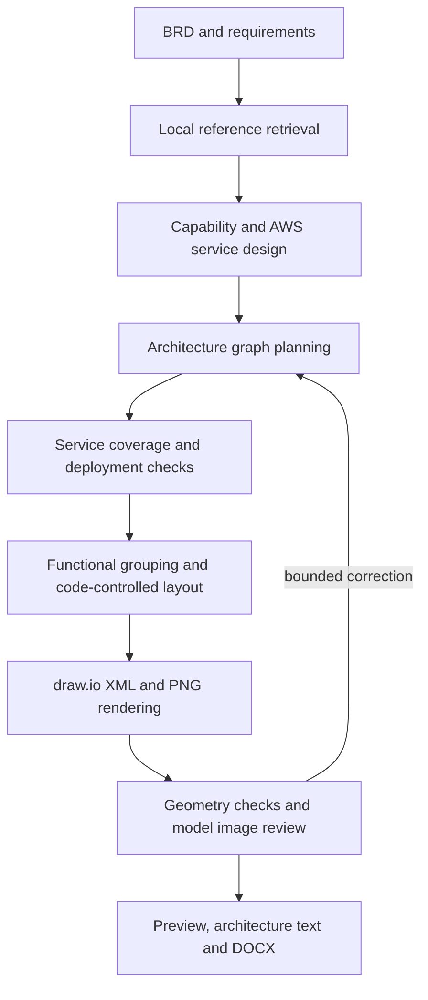

# Architecture knowledge base

Reviewed expansion: **10 November 2026**. The active library contains **50 cards:
40 official AWS text references and 10 retained, reviewed user diagram examples**.
Twenty AWS cards were added and the document-extraction and RAG cards refreshed.
This is a curated cross-workload library, not an exhaustive AWS catalogue or a
certification of generated designs.

Research starts at the [AWS Architecture Center](https://aws.amazon.com/architecture/)
and follows reference architectures, decision guides, service documentation,
Prescriptive Guidance and Well-Architected lenses. Each card links to its supporting
page. Source text is paraphrased. Layout advice is our synthesis for this generator,
rather than a claim that AWS mandates those coordinates or styling.

## Contents and coverage

| File | Purpose |
|---|---|
| `aws-patterns.json` | 20 additional AWS patterns with service choices, relationship checks and layout guidance |
| `patterns.json` | Original 20 AWS patterns, including refreshed OCR and RAG guidance |
| `AWS_CATALOG.md` | Index of all 40 official AWS cards and sources |
| `user-patterns.json` | 10 reviewed user examples; customer details must not be copied |
| `catalog.html` | Existing user-reference visual catalogue |
| `curated-import.json` | User-reference provenance and image hashes |
| `CONVENTIONS.md` | Boundary and presentation conventions |

| Area | Included guidance |
|---|---|
| Web and APIs | Browser workbench, serverless API, GraphQL, API composition, real-time backend, private ingress |
| Compute | Containers, ECS/EKS/Fargate choices, queued batch jobs |
| Migration | Database full load/CDC, native tooling, file/media copy, source/target ownership, hybrid networks |
| Data | Relational/key-value choices, RDS failover versus read scaling, lakes, streaming, search |
| AI and documents | Asynchronous Textract, RAG, agent runtime, model inference, audio and media |
| Integration | Queues/topics/event buses, transactional events, callbacks, orchestration and human review |
| Security | Application identity, account ownership, private endpoints, tenant isolation |
| Operations | Recovery, budget notifications, approved remediation, logging |

Each card records applicability, retrieval phrases, exclusions, flow, layout,
source URL, review date/type and evidence anchors. New cards include conditional
service choices and relationship checks. These are **prompt guidance**, not new
hard-coded validators or a mandatory inventory. Seventeen official cards are marked
historical topology examples. Review dates are not AWS publication dates.

## Retrieval

`app/diagram/knowledge.py` validates and caches the JSON libraries per process.
Official sources require the exact HTTPS host `docs.aws.amazon.com`; user-reference
images require a safe local path and matching SHA-256. New AWS IDs cannot silently
overwrite old IDs. Previously curated user overrides retain their precedence.

Deterministic phrase matching ranks workload patterns before implementation
decisions and generic controls. The standalone selector defaults to three results;
prompt assembly requests **up to six whole cards within 10,000 characters**.
Oversized cards are skipped and logged, never sliced into partial JSON.

Explicit exclusions veto matching capabilities. “Source clone, not production”
retains migration guidance; “OCR is not required” excludes OCR guidance. Previous
generated designs, raw-document transport fields and internal metadata do not steer
retrieval. This conservative lexical method can miss unfamiliar wording; it has no
embedding similarity score.

References stay separate from source evidence and cannot establish client facts,
extra scope, prices, volumes, SLAs or existing infrastructure. On library failure,
logs and service-design metadata report `library_unavailable`; source-based
planning continues. Retrieval adds no model call, live web request, vector database
or managed Bedrock Knowledge Base.

## Solution-architecture pipeline



1. **Source interpretation:** the application extracts the BRD and normalizes
   capabilities, exclusions, existing systems and proposed choices.
2. **Service selection:** `app/diagram/service_design.py` retrieves references
   before asking the configured diagram model to map source-evidenced capabilities
   to services, workflows, alternatives and open decisions. Reference text cannot
   supply fabricated source quotes. The saved `reference_knowledge` audit contains
   selected IDs, library version, omitted cards and context digest.
3. **Reuse:** the service-design fingerprint includes source facts, rules and
   reference version/content. Changed knowledge invalidates a cached design.
4. **Graph planning:** `app/diagram/service.py` supplies the service contract,
   source evidence, system/design rules, icon candidates and relevant references.
   The model produces structured nodes, directed edges, decisions and scopes.
   A matching, integrity-checked user reference PNG may accompany the existing
   model request; AWS source images are not downloaded during generation.
5. **Validation:** existing code checks graph structure, service coverage, icon
   identity, containment and supported relationships. Bounded corrective requests
   address failures. The new card checks are advisory reasoning guidance.
6. **Composition:** `app/diagram/narrative.py` groups the fixed graph into meaningful
   subsystems. It receives arrangement guidance from the previously selected IDs
   (up to 2,500 characters), without reselecting from generated prose. Code searches
   row arrangements and routes connectors. The editable connection-detail page
   retains the complete relationships. References cannot add services or edges.
7. **Rendering/review:** code builds draw.io XML and the renderer exports PNG.
   **draw.io does not choose the architecture or interpret the BRD.** Geometry
   checks and model image review inspect the result, with existing bounded repair
   and retry budgets. Hard architecture/structure failures prevent an invalid
   diagram from being published. Cosmetic warnings or reviewer unavailability can
   retain a valid rendered image with a warning; the SOW text can remain available.
8. **Delivery:** assets enter preview storage and DOCX output. Architecture text
   uses the selected design to explain component purposes and flow. Architecture
   writing and image review also use the shared advisory selector; unrelated SOW
   sections do not receive this context.

This update does not change the model profile, rendering engine or retry/time
budgets. Better reference inputs cannot guarantee correct or attractive output
on every run.

## Validation and maintenance

From `backend`:

```powershell
.\venv\Scripts\python.exe scripts/validate_architecture_knowledge.py
.\venv\Scripts\python.exe scripts/inspect_architecture_knowledge.py --query "database migration from a source clone"
.\venv\Scripts\python.exe scripts/inspect_architecture_knowledge.py --inputs output/llm-debug/<Architecture_Inputs.txt>
.\venv\Scripts\python.exe scripts/build_architecture_catalog.py
.\venv\Scripts\python.exe -m pytest tests/test_aws_reference_knowledge.py tests/test_architecture_knowledge.py tests/test_service_design.py tests/test_narrative_architecture.py -q
```

The inspection script accepts repeated `--inputs` and `--query` arguments and
performs no network/model calls. Its report records IDs, sources, digest and budget
decisions without copying BRD content: `output/architecture-knowledge-retrieval.json`.

The local audit checks all 50 cards, retrieval and image integrity. Its optional
`--online` mode checks AWS source reachability, evidence anchors and content hashes
using bounded requests and robots.txt rules. Online validation is manual maintenance,
never a generation dependency. HTTP success alone does not validate an architecture.

Review sources before changing cards, add positive/excluded/mixed-workload tests,
and bump the library version. Rebuild the source catalogue. **Restart the backend**
to load changed code/cards; regenerate an existing preview's architecture to apply
the changes. Existing previews are not silently rewritten.

Offline tests cover retrieval, exclusions, budgets, early planner injection,
provenance, cache invalidation and layout guidance. Saved BRD-derived inputs for
Kingfisher, Wise, Apollo and the booking portal were checked through retrieval.
These are not fresh paid Bedrock generations or visual acceptance of new diagrams.

The ten user-reference images and prior review decisions are preserved. The
underwriting example remains text-only because its pictured managed-service
containment is misleading. Existing image import tooling remains unchanged.
